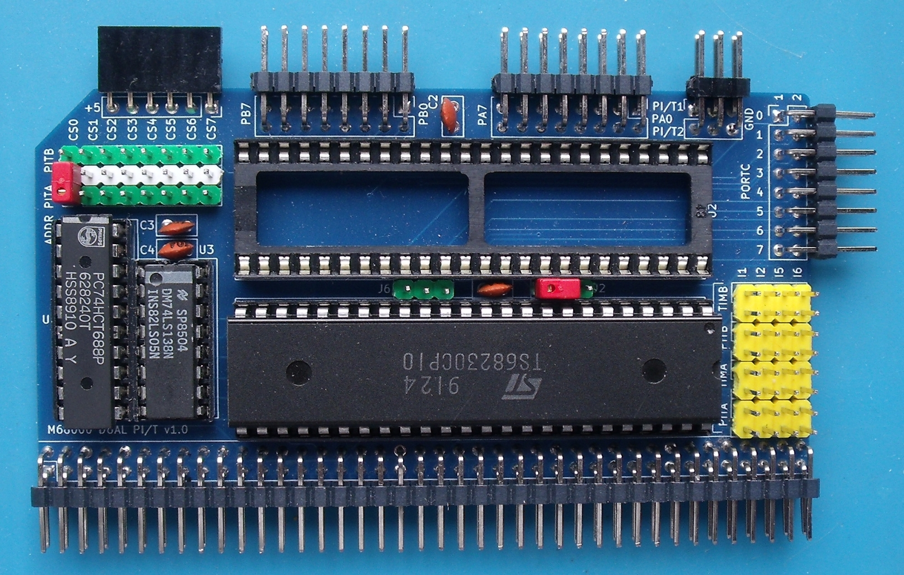

# Dual Parallel I/O Board

# Details
The parallel board is populated with two 68230 Parallel Interface / Timer chips. Both PI/T chips do not have to be fitted. The board will work with just one chip fitted.

## Address Decoding
The address decoding is carried out by a 74LS688 combined with a 74LS138 to generate 8 separate 2048 byte blocks residing between addresses $D08000 and $D0BFFF.

The base address of each PI/T is determined by the placement of a jumper between adjacent pins on J7 & J12 (PI/T A) and J7 & J13 (PI/T B).

## Device Register Access
The registers of the PI/T are 8 bits wide and are accessed on consecutive ODD addresses from the base address set by the address decode logic. Assuming that the /CS0 jumper has been fitted for PI/T #1, then the first few registers are accessed on the following addresses:
+ $D08001 : Port General Control Register
+ $D08003 : Port Service Request Register
+ $D08005 : Port A Data Direction Register

## DTACK
Each PI/T generates its own /DTACK signal internally which is then routed back to the processor via RCBus-80 pin 62.

## Clock Source
Each PI/T chip **requires** a clock signal in order to function correctly, even if the timer is not being used. The clock can be sourced from either the system clock or CLOCK2 depending on the jumper settings on J2 and J6.

## Interrupts
Each PI/T chip has a port interrupt and a timer interrupt. These can be assigned to an interrupt level of 1,2,5 or 6 depending on the jumper positions set on J8,J9,J10 & J11.

## Input / Output Pins
The 2 8-bit ports on each PI/T are routed to connectors along the top of the board. Connector J1 carries the port A pins for both PI/T chips and connector J4 carries the port B pins for both PI/T chips.

Note that the board **does not have** any protection built in to prevent damage to the PI/T chips if one of these pins is mis-used.

# Board Assembly
Assembly of the board should be fairly straightforward. There are no surface mount devices to deal with.

When fitting the 80-pin right angle connector, initially only solder a couple of pins at opposite ends of the connector so that you can make any adjustments if the board is not vertical when fitted to the backplane.

Note the orientation of the two PI/T chips - they are effectively upside down.

# Jumpers
+ J1: PORTA i/o pins for both PI/T chips - refer to schematic
+ J2: Select RCBus CLOCK or CLOCK2 for PI/T #1 clock source - see notes below
+ J4: PORTB i/o pins for both PI/T chips - refer to schematic
+ J5: PORTC i/o pins for both PI/T chips - refer to schematic
+ J6: Select RCBus CLOCK or CLOCK2 for PI/T #2 clock source - see notes below
+ J7: IO Address selection
  + $D08000
  + $D08800
  + $D09000
  + $D09800
  + $D0A000
  + $D0A800
  + $D0B000
  + $D0B800
+ J8: Select the interrupt line for PI/T #1 timer interrupt
+ J9: Select the interrupt line for PI/T #1 port interrupt
+ J10: Select the interrupt line for PI/T #2 timer interrupt
+ J11: Select the interrupt line for PI/T #2 port interrupt+ J12 (with J7): Specify the IO Address for PI/T chip #1
+ J12: (with J7): Specify the IO Address for PI/T chip #1
+ J13: (with J7): Specify the IO Address for PI/T chip #2
+ J14: All contacts connected to GND
+ J15: All contacts connected to +5V

# Reliability Issues
The numerous reliablity issues with my 68230 boards have been resolved. The fault was eventually tracked down to the 4K7 pullup resistor for the /DTACK signal on the processor board. With a value of 4K7, there wasn't a strong enough pull up on the /DTACK line and frequently the /DTACK signal from the previous bus access was being interpreted as a /DTACK on the current bus access. Wiring a 1K3 resistor in parallel with the 4K7 - resulting in about a 1K pull up - caused /DTACK to rise much faster and the 68230 responded correctly.

The /DTACK pull up correction has now been applied to all my processor boards and they all seem to behave correctly.

# Errors
+ The 68230 chip select has to include one of the /nDS signals not just /AS. Fix by cutting the /AS track between RCBus pin 41 and the 74LS688 pin 1. Add a wire link between RCBus pin 43 (/LDS) and the 74LS688 pin 1.
+ The +5V right angle female header (J15) is quite fragile and on my board, it breaks off quite easily.
