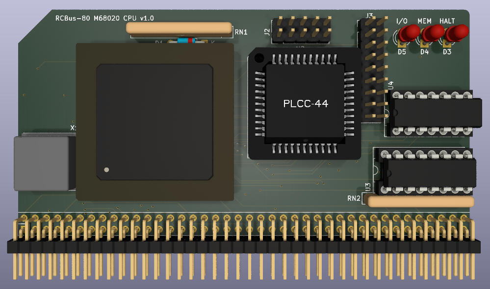

# 68020 Processor Board

This is a 3D render of what my first attempt at a 68020 processor for RCBus would have looked like. This design never made it to actual hardware as it was superseeded by my RC205 68020 board after the success of my vectored interrupt version of the 68000 (RC201). 

