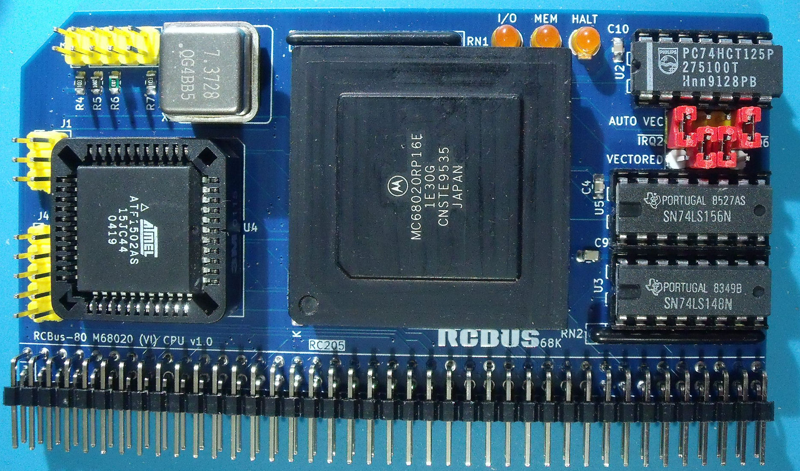
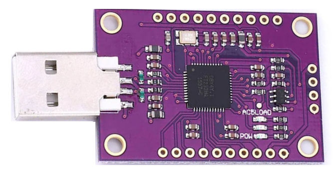

# RC205 - 68020 Processor Board

Actual image of the processor board under test with IRQ2 & IRQ6 configured for autovectored interrupts and IRQ3 & IRQ5 configured for vectored interrupts.



# Details
The processor board consists of a PGA packaged MC68020 processor, a single CPLD, bits of glue logic and the processor clock source.

The processor board is designed to plug into an RCBus-80 backplane and expects to find the stack pointer and initial program counter addresses at location 0x000000 onwards.

## Reset
The reset signal for the processor board must be supplied externally, entering the board via pin 20 of the RCBus connector. This should not be an issue if you are using one of Steve Cousins's backplanes.

## Processor Clock
The processor/system clock source is an oscillator in an 8-pin DIL/DIP can (X1 in the schematic). Basic testing was done with a 7.3728MHz oscillator. 

## DTACK & Bus Error
A /DTACK signal is generated using a counter within the ATF1502 CPLD only when an address within the /MREQ or /IORQ address windows are activated. At all other times, the external board is expected to provide its own /DTACK signal.
  
A Bus Error is also implemented using further stages of the /DTACK counter within the ATF1502 CPLD. Note that in theory a bus error will never be generated when an address that falls within the /MREQ or /IORQ address windows is accessed.

## RCBus Memory Space
My RC205 68020 design partially decodes 2 blocks of memory within the 68020 address range as follows:
| Address Range | Signal |
| :---- | :---- |
| 0xF80000..0xF9FFFF | /MREQ goes low |
| 0xFA0000..0xFBFFFF | /IORQ goes low |

**NOTE** These address ranges are different to previous I/O and memory space address ranges used on older boards but should be the same as used on the RC201 68000 board.

This partial decoding results in the RCBus I/O and memory spaces appearing multiple times within the 68020 address range. A /DTACK signal is generated on the processor card for any access to the RCBus whether there is a device present at that address or not.

For both I/O and memory spaces, consecutive memory locations are accessed on the ODD bytes such that I/O address 0x00 is accessed at address 0xFA0001, address 0x01 is accessed at address 0xFA0003 etc.

## Onboard LEDs
There were a couple of gates left over and I've used them to drive and activity LED for accesses to the RCBus Memory & I/O space as well as a HALT LED. Note that the I/O LED will only glow faintly.

# Board Assembly
Assembly of the board should be fairly straightforward. There are a few surface mount 0805 resistors and capacitors to deal with but these should be relatively easy to solder with a fine tipped soldering iron.

After my experience creating a PGA socket out of several SIL turned pin sockets for my 68302 board, I seriously recommend a proper PGA socket for this processor. Look for a 13x13 PGA socket to begin with. There are sockets out there that are 13x13 with more pins than required. These can either be cut off or even pushed out of the socket housing.
 
If you choose have a turned pin socket for the system clock, then an 8-pin DIL surned pin socket can be used. I flipped the socket over - so pins pointing upwards - and easily pushed out pins 2,3,6 & 7.

A **note of caution** when using a socketed oscillator - there is the possibility that the metal can of the oscillator could accidentally short out pins on the next board. You can trim the 4 pins of the oscillator so it sits flush with the socket if this is an issue for your board. Please be aware of this.

Make sure you insert the chips into their sockets in the correct orientation. Also pay attention to the orientation of the 68020 processor as it is easy to insert it into the PGA socket in the wrong orientation.

When fitting the 80-pin right angle connector, initially only solder a couple of pins at opposite ends of the connector so that you can make any adjustments if the board is not vertical when fitted to the backplane.

Note that J1 & J4 are only needed when if debugging the ATF1502AS CPLD.

# Firmware
The board uses an ATMEL ATF1502AS CPLD device to contain the bulk of the logic required. The device can easily be programmed using a simple USB adapter - look for an FT232H breakout board. Mine looks like this one:



## Connections
Only 5 wires are required to be connected from the FT232H breakout board to the 68020 board as follows:
+ AD0 to TCK
+ AD1 to TDI
+ AD2 to TDO
+ AD3 to TMS
+ GND to GND
+ 5V  to 5V (see below)

Simple Dupont female to female jumper leads should suffice. Note that if powering the board from the RCBus backplance, then the 5V wire is not required. If simply powering the board in isolation, then the 5V lead is required.

## Development
I used WinCUPL version 2 to develop the code that is programmed into the CPLD. I'm new to the world of CPLDs so what I've done may not be the best way to do it.

## Programming
The CPLD is programmed using [OpenOCD](https://openocd.org/pages/getting-openocd.html). I've converted the WinCUPL .JED file into the equivalent .SVF file which OpenOCD requires. I also had to use the Zadig tool to set the Windows 11 device driver for the "Single RS232-HS" device to libusb-win32

Before attempting to program the CPLD, I recommend checking to see if OpenOCD can detect the device. From a Windows 11 command window, navigate to the OpenOCD root folder on your PC and type the following:

```
.\bin\openocd.exe -f .\openocd\scripts\interface\ftdi\um232h.cfg -c "adapter speed 400"  -c "transport select jtag" -c "jtag newtap ATF1502AS tap -irlen 3 -expected-id 0x0150203f" -c init -c shutdown
```

That should report back that an ATF1502AS device has been found.

To program the SVF file - assuming it is called RC205.svf - I then typed the following:

```
.\bin\openocd.exe -f .\openocd\scripts\interface\ftdi\um232h.cfg -c "adapter speed 400"  -c "transport select jtag" -c "jtag newtap ATF1502AS tap -irlen 3 -expected-id 0x0150203f" -c init -c "svf RC205.svf" -c "sleep 200" -c shutdown
```

There should be lots of printing to the console and after around 15 seconds or so it should report back that the device has been programmed. Note that the above assumes that the SVF file is in the current folder so you may need to add a path to your SVF file.

# Software
The 68020 should run the same code that my 68000 does. The updated monitor code can be found in the ASM_CODE folder - called rcMON68K_v2.0. The monitor was initially developed using EASy68K. Note that this monitor requires the RC208 auto switching memory card so that RAM is correctly positioned at address 0x000000 after booting.

## Interrupts
The monitor program assumes that one of the auto switching memory boards in being used and that once the initial stack pointer and program counter have been read, the ROM automatically moves to address 0x700000 onwards. The exception vector table is then copied into RAM at address 0x000000 ready for use.

This processor card supports a mixture of vectored and autovectored interrupts. Interrupt levels 1, 4 & 7 are always autovectored whereas interrupt levels 2, 3, 5 & 6 can be configured via jumpers to be either vectored or autovectored interrupts.

In order to use your own exception handler, simply overwrite the RAM exception vector table entry with the address of your own handler.

# Jumpers
+ J1: Debug header for the ATF1502AS CPLD and does not need to be fitted.
+ J3: JTAG programming header for the ATF1502AS CPLD.
+ J4: Debug header for the ATF1502AS CPLD and does not need to be fitted.
+ J5: IRQ5 : 1-2 for auto vectored interrupts or 2-3 for vectored interrupts.
+ J6: IRQ6 : 1-2 for auto vectored interrupts or 2-3 for vectored interrupts.
+ J7: IRQ2 : 1-2 for auto vectored interrupts or 2-3 for vectored interrupts.
+ J8: IRQ3 : 1-2 for auto vectored interrupts or 2-3 for vectored interrupts.

# Future Enhancements
Nothing yet.

# Errors
Nothing yet - but give it time :-(

# History
+ v1.1 - added missing A17 & A18 address lines to the CPLD
+ v1.0 - initial design
