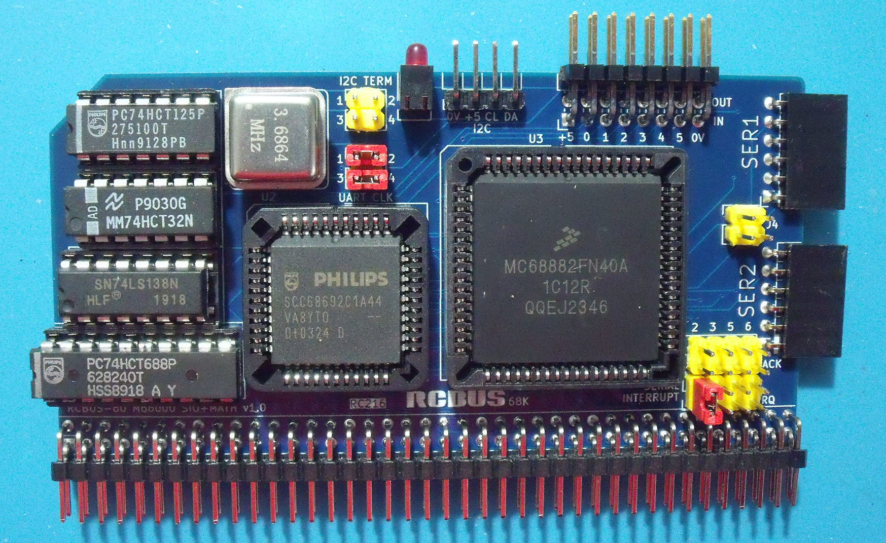

# RC216 - 68692 Serial I/O Board + 68881 (or 68882) maths coprocessor

Image of the RC216 board during testing.

# Details
The serial I/O board consists of a PLCC packaged Philips SCC68692 DUART, an MC68881 (or MC68882) maths coprocessor and 4 discrete logic ICs. The board also provides a bit-banged I2C interface with optional bus termination.

The SCC68692 DUART is compatible with MC68681 but supports up to 115200 baud via a test mode. The test mode is documented in the Philips Semiconductors document titled "Extended baud rates for SCN2681, SCN68681, SCC2691, SCC2692, SCC68681 and SCC2698B". I've put a PDF of this document in the board folder.

The 2 serial ports are each fed to a 6-pin connector at the board edge. The layout of the 6 pins is compatible with an FTDI USB-TTL Serial interface board.

The I2C port is fed to a 4-pin connector at the board edge.

The maths coprocessor is configured for 16-bit mode and is accessed as a **peripheral device**.

## Address Decoding
The address decoding is carried out by a 74LS688 combined with a 74LS138 to generate the required chip selects. The chip selects are hard wired such that:
+ SCC68692 DUART is at address $D00000 onwards.
+ MC68881 is at address $D03800 onwards.

If using additional serial boards, make sure that their addresses are different.

## Device Register Access
The registers of the 68681 DUART are 8 bits wide and are accessed on consecutive ODD addresses from the base address set by the address decode logic. The first few registers are accessed on the following addresses:
+ $D00001 : Mode Register A (R/W)
+ $D00003 : Status Register A (R) / Clock Select Register A (W)
+ $D00005 : Command Register A (W)

The registers of the MC68881 maths coprocessor are accessed on consecutive addresses from the base address. The first few registers are accessed on the following addresses:
+ $D03800 : Response Register
+ $D03802 : Control Register
+ $D03804 : Save Register

## DTACK
The 68692 and 68881 both generate their own /DTACK signals internally which are then routed back to the processor via RCBus-80 pin 62.

## Interrupts
The board design supports autovectored interrupt generation at levels 2,3,5 or 6 depending on the placement of a jumper on J9. The processor card must also be configured to support autovectored interrupts at the same interrupt level.

The board also supports vectored interrupts at levels 2,3,5 or 6 by placing a jumper on the appropriate pins of J9 and J12. When using vectored interrupts, the same interrupt level must be set on both J9 and J12. The processor card must also be configured to support vectored interrupts at the same interrupt level.

## Baud Rate Generator Clock
The clock signal for the baud rate generator can be sourced from the on board 3.6864MHz crystal oscillator (X1 in the schematic) or from an external clock source on the RCBus-80 CLOCK2 pin (pin 61) via the jumper J10.

The jumper J10 can also be configured to route the baud rate generator clock to the CLOCK2 pin on the RCBus-80 connector.

## Discrete Outputs
6 of the discrete outputs from the DUART are routed to J8 on the edge of the board. J8 also provides GND and +5V signals. Note that the board **does not have** any protection built in to prevent damage to the DUART if one of these pins is mis-used.

The discrete outputs have alternate functions to support serial handshaking as well as I2C data transfers as follows:

| Output Pin | Details |
| :---- | :---- |
| OPA0 | Serial #1 CTS |
| OPA1 | Serial #2 CTS |
| OPA5 | I2C SDA control |
| OPA6 | I2C SCL control |
| OPA7 | USER LED |

## Discrete Inputs
The 6 inputs to the DUART are also routed to J8 on the edge of the board. J8 also provides GND and +5V signals. Note that the board **does not have** any protection built in to prevent damage to the DUART if one of these pins is mis-used.

The discrete inputs have alternate functions to support serial handshaking as well as SPI and I2C data transfers as follows:

| Input Pin | Details |
| :---- | :---- |
| IPA0 | Serial #1 RTS |
| IPA1 | Serial #2 RTS |
| IPA5 | I2C SDA state |

## Serial Port Flow Control
Serial hardware flow control can be achieved on each of the 2 serial ports by shorting the appropriate solder jumpers (JP1,2,3 & 4) on the rear of the board. This routes the 2 flow control signals for each serial port to an input pin and an output pin on the DUART. You may well find that only JP2 and JP4 are required to be bridged to allow the DUART to tell the host to stop transmitting. 

# Board Assembly
Assembly of the board should be fairly straightforward. There are a few surface mount 0805 resistors and capacitors to deal with but these should be relatively easy to solder with a fine tipped soldering iron.

If you choose have a turned pin socket for the system clock, then an 8-pin DIL turned pin socket can be used. I flipped the socket over - pins pointing upwards - and easily pushed out pins 2,3,6 & 7.

A **note of caution** when using a socketed oscillator - there is the possibility that the metal can of the oscillator could accidentally short out pins on the next board. Please be aware of this.

When fitting the 80-pin right angle connector, initially only solder a couple of pins at opposite ends of the connector so that you can make any adjustments if the board is not vertical when fitted to the backplane.

# Jumpers
+ J4: Fit 1-2 and 3-4 to route serial port #1 TX & RX onto the RCBus-80 pins 35 & 36.
+ J5: I2C bus connector
+ J6: Serial #1 port
+ J7: Serial #2 port
+ J8: Exposes the 6 digital outputs and 6 digital inputs of the DUART as well as GND and +5V. Note that there is **NO** input or output protection circuitry.
+ J9: IRQ levels 2,3,5 & 6
+ J10: Specifies the clock source for the DUART baud rate generator
  + 1-3 Use the onboard clock source
  + 1-2 Use the RCBus clock source from CLOCK2
  + 1-2 *and* 3-4: Use the onboard clock source and supply the RCBus CLOCK2 signal with the clock.
+ J11: I2C bus terminating resistors (4K7)
  + Fit 1-2 to enable SCL pull up resistor
  + Fit 3-4 to enable SDA pull up resistor
J12: Interrupt acknowledge level used with vectored interrupts only and should match the level on J9 when used.

# Errors
None so far.
